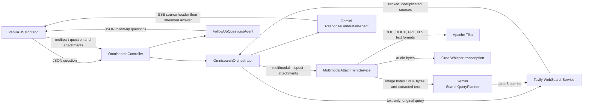

# OmniSearch Backend — Architecture and Resume Notes

> This document describes the backend currently present in this repository. It is intended as a study and resume-preparation aid, not as a claim of production traffic or measured model quality. The project has been implemented collaboratively with AI assistance; only describe decisions and code you can explain confidently in an interview.

## Project overview

OmniSearch is a Spring Boot research assistant. It accepts a question, retrieves web evidence through Tavily, asks Google Gemini to synthesize a cited answer, and streams the answer to a vanilla JavaScript frontend using Server-Sent Events (SSE). The multimodal route also accepts images, documents, and audio: image/PDF bytes can be sent to Gemini, Tika extracts text from supported documents, and Groq Whisper transcribes audio before search planning.

The frontend is served by the same Spring Boot application from `src/main/resources/static/`. The backend code targets Java 21, Spring Boot 3.5.5, and Spring AI 1.1.0 (`pom.xml`).

## Architecture at a glance

### Main request paths

**Text-only question**

1. The frontend posts JSON `{ "query": "...", "conversationId": "..." }` to `POST /api/omnisearch/conversation/stream`.
2. `OmnisearchController` passes the request to `OmnisearchOrchestrator`.
3. `WebSearchService` sends the query to Tavily. The current text route uses one Tavily request, basic search depth, and requests up to 10 results with raw content.
4. The orchestrator creates a `SearchContext` and emits a leading `<!--SOURCES:...-->` SSE chunk so the frontend can render source cards before the answer.
5. `ResponseGenerationAgent` streams Gemini Flash-Lite output using prompt templates that specify answer structure and numbered citations. The existing text path uses Spring AI's `MessageChatMemoryAdvisor` with the conversation ID.

**Image, document, audio, or mixed attachments**

1. The frontend posts `multipart/form-data` to `POST /api/omnisearch/conversation/stream/multimodal`, with optional `query`, optional `conversationId`, and repeated `attachments` parts.
2. `MultimodalAttachmentService` checks file count, byte limits, file signatures/MIME and supported extension/type combinations before processing.
3. Images are retained as request-scoped bytes for Gemini vision. Documents are parsed by Tika on a bounded executor. PDFs also retain their media bytes for Gemini; office/text documents pass extracted text. Audio is sent to Groq's `/audio/transcriptions` endpoint using `whisper-large-v3-turbo`; only its transcript is carried forward.
4. `SearchQueryPlanner` sends the question, extracted text/transcript, and supported media to Gemini Flash-Lite and parses up to three concise Tavily queries. If planning fails and a typed question exists, it falls back to that query; attachment-only requests need the planner to derive a usable query.
5. Planned Tavily requests run with concurrency capped at three. Results are ranked by score, deduplicated by canonicalized URL, and capped at 10. The response generator receives web context and the current turn's original image/PDF media.
6. The response streams in the same SSE format. For multimodal turns, the code writes sanitized text and the completed answer to in-memory chat memory rather than adding raw attachment bytes.

After a completed answer, the frontend can call `POST /api/omnisearch/followups`; `FollowUpQuestionsAgent` returns generated questions as JSON. The follow-up endpoint is separate from both answer streams.

## Implemented safeguards and explicit limits

These are configuration or code limits, **not performance benchmarks**:

| Area | Current setting or behavior | Evidence in repository |
|---|---|---|
| Attachments per multimodal request | 5 files maximum | `MultimodalAttachmentService`, `application.properties` |
| Upload size | 20 MB per file; 40 MB per request | `application.properties`, Spring multipart properties |
| Extracted text | 40,000 characters per document; 100,000 across attachments | `MultimodalAttachmentService`, `application.properties` |
| Tika work | 3 worker threads, queue capacity 12, 30-second parser timeout | `TikaExecutorConfig`, `MultimodalAttachmentService` |
| Search planning | 1–3 generated queries | `SearchQueryPlanner` |
| Search fan-out | Maximum concurrency 3 | `OmnisearchOrchestrator` |
| Sources per multimodal turn | Up to 10 unique URLs; each source excerpt capped at 4,000 characters | `OmnisearchOrchestrator` |
| Combined multimodal research context | Capped at 50,000 characters | `OmnisearchOrchestrator` |
| Chat memory | In-memory window capped at 20 messages | `ChatMemoryConfig` |
| Tavily timeout | 30 seconds per request | `WebSearchService` |
| Groq transcription timeout | 3 minutes per request | `GroqTranscriptionService` |

Uploads are held in memory for the request and are not written to a database by this path. Provider keys are read from environment variables (`GEMINI_API_KEY`, `TAVILY_API_KEY`, `GROQ_API_KEY`); do not put actual keys in source code, screenshots, or this document. The current Tavily provider failure path returns an error instead of fabricating a source.

## Technology and design choices

- **Spring MVC + WebFlux:** MVC controllers bind JSON and multipart uploads; WebFlux `Flux` and `ServerSentEvent` stream generated answer chunks.
- **Spring AI + Gemini:** `ChatClient` instances use `gemini-3.5-flash-lite` for response generation, query planning, and follow-up generation.
- **Tavily:** Dedicated `WebSearchService` encapsulates external search requests and the Tavily request/response models.
- **Apache Tika:** Existing Spring AI Tika dependency is used for content detection and document text extraction.
- **Groq Whisper:** A focused `GroqTranscriptionService` calls the transcription API with multipart audio and parses its JSON transcript.
- **Reactive composition:** `OmnisearchOrchestrator` composes attachment handling, planning, concurrent searches, source construction, and answer streaming while keeping provider-specific code in separate services/agents.
- **Prompt separation:** System and user prompt templates are resource files, keeping answer/citation rules separate from orchestration code.
- **Operational logs:** Stage logs record counts, sizes, durations, and error classes. They avoid logging file contents, transcript contents, prompts, or secrets.

## Measurable facts you can support

- **5 backend routes** are declared in `OmnisearchController`: non-streaming conversation, streaming text conversation, streaming multimodal conversation, follow-ups, and health.
- **3 input modalities** are processed in the multimodal attachment service: image, document, and audio. Mixed attachments are processed as one turn.
- **3 query candidates maximum** can be planned per multimodal request, with **3 concurrent search calls maximum** and **10 unique source cards maximum** in the merged result set.
- **20 MB/file and 40 MB/request** are configured upload limits; these values are directly visible in `application.properties`.
- The main source tree contains **23 Java classes/files at the last successful compile**. Count can change as the project evolves; use `rg --files src/main/java | Measure-Object` to recount.
- A local Maven compile completed successfully with `-DskipTests` during implementation. The only checked-in test found is a Spring application context test; there are no checked-in integration tests demonstrating live Gemini, Tavily, or Groq requests.

Do **not** claim request throughput, latency improvement, transcription accuracy, search relevance, uptime, user counts, or production deployment from these facts. Those require measurements or deployment evidence that is not present in this repository.

## Resume wording (adapt to your contribution)

### Project description

**OmniSearch — AI-powered web research assistant** | Java, Spring Boot, Spring AI, WebFlux, Gemini, Tavily, Apache Tika, Groq Whisper

Built a research assistant backend that streams source-cited answers from web search and supports text, image, document, and audio input. Designed a modular Spring pipeline for attachment validation and extraction, multimodal search-query planning, bounded parallel web retrieval, citation-aware answer generation, and follow-up questions.

### Evidence-based bullets

- Implemented Spring Boot JSON and multipart SSE endpoints for text and multimodal research requests, preserving a shared streaming response and source-citation format.
- Added multimodal ingestion for image, PDF, office/text documents, and audio, with limits of 5 files per request, 20 MB per file, and 40 MB per request.
- Integrated Gemini Flash-Lite for image-aware search planning and grounded answer generation, Tavily for web retrieval, Apache Tika for document parsing, and Groq Whisper for audio transcription.
- Bounded multimodal processing with a 3-worker Tika executor, parser/provider timeouts, 1–3 planned searches, at most 3 concurrent search calls, and a 10-source merged result cap.
- Added URL deduplication, numbered source payloads for the frontend, per-stage diagnostic logs, externalized provider credentials, and sanitized in-memory context for multimodal turns.

If your resume needs to distinguish AI-assisted implementation, a truthful phrasing is: “Designed and implemented with AI-assisted development; reviewed and validated the Spring request flow, limits, streaming contract, and provider integrations.” Keep that only if it accurately reflects what you personally reviewed and can explain.

## Interview walkthrough checklist

Be ready to explain:

1. Why text-only and multipart multimodal requests have separate endpoints.
2. How the source header is sent before answer tokens and how citation indices map to the returned results.
3. Why Tavily requests are bounded and URLs deduplicated before building the prompt.
4. Why Tika parsing is isolated from the reactive event loop and protected by limits/timeouts.
5. How the transcription endpoint differs from translation, and how transcript text enters query planning.
6. What data enters chat memory, what does not, and why the current memory is process-local rather than durable.
7. Which behaviors are compile-verified versus provider/runtime-tested. Currently, compilation is verified; live provider round trips and modality-specific integration tests are not evidenced by checked-in tests.

## Repository evidence map

- API surface: `src/main/java/com/ojashwa/springai/omnisearch/controller/OmnisearchController.java`
- Request orchestration, source ranking, URL deduplication, and SSE prelude: `src/main/java/com/ojashwa/springai/omnisearch/service/OmnisearchOrchestrator.java`
- Upload detection, validation, Tika extraction, and modality dispatch: `src/main/java/com/ojashwa/springai/omnisearch/service/MultimodalAttachmentService.java`
- Groq audio API: `src/main/java/com/ojashwa/springai/omnisearch/service/GroqTranscriptionService.java`
- Gemini search planner and response agent: `src/main/java/com/ojashwa/springai/omnisearch/agent/SearchQueryPlanner.java`, `ResponseGenerationAgent.java`
- Tavily provider integration: `src/main/java/com/ojashwa/springai/omnisearch/service/WebSearchService.java`
- Runtime limits and environment-backed credentials: `src/main/resources/application.properties`
- Prompt rules: `src/main/resources/promptTemplates/`
- Dependencies and Java/Spring versions: `pom.xml`
