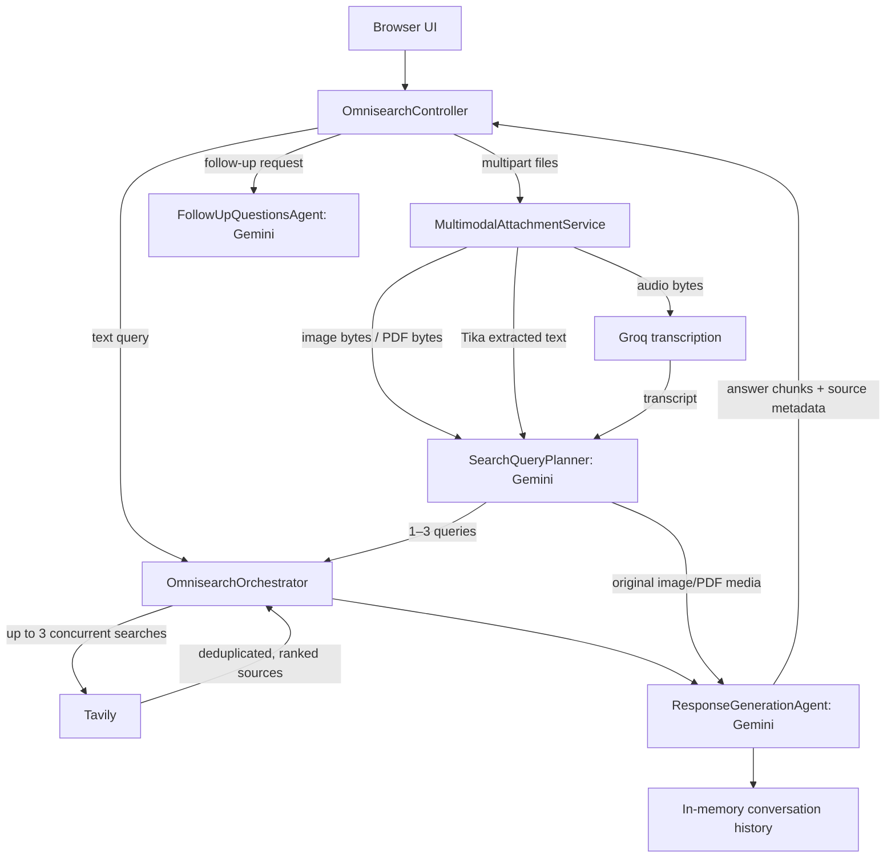

# OmniSearch

OmniSearch is a Spring Boot research assistant with a Perplexity-style workflow. It accepts a question, researches it with Tavily, and streams a source-grounded answer generated by Google Gemini. Its multimodal endpoints also accept images, documents, and audio. Attachments become evidence for search planning and answer generation; the application does not build a persistent media library.

## At a glance

- **Text search:** query → Tavily → bounded research context → streamed Gemini answer.
- **Multimodal search:** question and uploaded evidence → Gemini query planner → parallel Tavily searches → Gemini answer with the original supported media attached.
- **Images:** validated and passed to Gemini as image media.
- **Documents:** text extracted with Apache Tika; PDFs are also passed to Gemini as PDF media.
- **Audio:** transcribed with Groq Whisper, then handled as text evidence.
- **Conversation continuity:** in-memory, bounded chat memory keyed by conversation ID; uploaded binary media is excluded from stored turns.

## Architecture



### Main components

| Component | Responsibility |
| --- | --- |
| `OmnisearchController` | HTTP API for text/multimodal searches, streaming, health, and follow-up questions. |
| `OmnisearchOrchestrator` | Coordinates ingestion, query planning, web search fan-out, context assembly, source ordering, and streamed output. |
| `MultimodalAttachmentService` | Enforces upload constraints, detects actual content types with Tika, extracts document text, retains supported media bytes for the current request, and delegates audio transcription. |
| `SearchQueryPlanner` | Uses Gemini Flash-Lite to derive up to three concise web queries from the question, extracted text, and attached image/PDF media. It returns structured JSON queries and falls back to the user’s text question if planning fails. |
| `WebSearchService` | Calls Tavily and maps results into the application’s search models. |
| `ResponseGenerationAgent` | Streams the researched response, includes source URLs in the model prompt, attaches image/PDF evidence for multimodal turns, and manages conversation history. |
| `FollowUpQuestionsAgent` | Generates a typed JSON follow-up response from the original question and completed answer. |
| `GroqTranscriptionService` | Sends audio to Groq’s transcription endpoint and returns transcript text. |

Prompt templates are under `src/main/resources/promptTemplates`. The browser UI and its CSS/JavaScript live under `src/main/resources/static`; `marked.min.js` renders Markdown. Runtime configuration is in `application.properties`.

## How multimodal input works

The multipart endpoints accept a text `query` (optional if files are supplied), an optional `conversationId`, and repeated `attachments` parts. The service first validates file count and sizes, then checks the content detected from bytes against supported type rules. A filename extension by itself is not sufficient to accept a file.

| Input | Ingestion and model path | Evidence retained for the turn |
| --- | --- | --- |
| JPEG, PNG, WebP, HEIC, HEIF | Detected with Tika, then supplied as media to Gemini’s query planner and response model. | Filename, image kind, MIME type; image bytes used for this request. |
| PDF | Tika extracts text; the PDF is also supplied as media to Gemini. | Extracted text and PDF bytes for this request. |
| DOC/DOCX, PPT/PPTX, XLS/XLSX, TXT, Markdown, HTML, CSV | Tika extracts text; extracted text is used by planner and answer model. | Filename, kind, MIME type, bounded extracted text. |
| Audio (supported formats listed below) | Bytes go to Groq `whisper-large-v3-turbo`; the transcript becomes planner and answer evidence. | Filename, kind, MIME type, transcript. Original audio is not placed in chat memory. |

For a mixed request, all usable text/transcripts and media are combined into a single planning step and a single answer. Extracted text is capped per document and across all attachments. Tika parsing runs on a dedicated bounded executor with a timeout so parsing work does not occupy the reactive event loop. Audio transcription has a provider timeout. Failures are reported with an attachment-specific message where possible.

The planner asks Gemini for one to three search queries and treats uploaded content as untrusted evidence, not instructions. Searches run with concurrency capped at three. Results are ranked, deduplicated by canonical URL, and capped at ten. If some planned searches fail, successful results can still be used; if all fail or none produce usable sources, the request returns an error rather than inventing citations.

The answer stream starts with hidden HTML comment metadata used by the frontend: attachment metadata (`ATTACHMENTS64`) and source metadata (`SOURCES`). These payloads precede answer text so clients can identify the source list consistently. The non-streaming multimodal endpoint consumes the same stream and returns parsed answer, sources, transcripts, counts, timing, and conversation ID.

## Conversation memory and data handling

Text answers use Spring AI’s `MessageChatMemoryAdvisor`. Multimodal answers explicitly load prior messages and add a sanitized user turn after successful completion: question, attachment names and extracted text/transcripts, research context, and answer. The raw image/PDF/audio bytes are not added to chat memory. `MessageWindowChatMemory` retains up to 20 messages in process memory; it is not durable storage and is lost when the application restarts. The project does not currently persist uploaded files or search history to a database.

## Requirements and configuration

- Java 21
- Maven (or the included Maven wrapper)
- Gemini API key for planning and answer generation
- Tavily API key for web search
- Groq API key for audio transcription only

Set credentials as environment variables; do not commit secrets:

```powershell
$env:GEMINI_API_KEY = "..."
$env:TAVILY_API_KEY = "..."
$env:GROQ_API_KEY = "..." # only needed for audio uploads
```

Current defaults in `application.properties` include Gemini model `gemini-3.5-flash-lite`, Groq model `whisper-large-v3-turbo`, maximum five files, 20 MB per file, 40 MB total attachments, 40,000 extracted characters per document, 100,000 extracted characters across the request, and a 30-second Tika timeout. Spring multipart limits are tied to the per-file and total request settings. These can be overridden through Spring property/environment configuration.

## Run locally

```powershell
./mvnw.cmd spring-boot:run
```

The application serves the browser UI and API from the same Spring Boot process. Open `http://localhost:8080/`. To package it:

```powershell
./mvnw.cmd clean package
```

## HTTP API

Base path: `/api/omnisearch`. JSON request DTOs use `query` and `conversationId` fields.

| Method and path | Content type | Behavior |
| --- | --- | --- |
| `POST /conversation` | JSON | Text search returning a stream of plain text chunks. |
| `POST /conversation/stream` | JSON → `text/event-stream` | Text search as Server-Sent Events. |
| `POST /conversation/multimodal` | `multipart/form-data` → JSON | Non-streaming multimodal response. |
| `POST /conversation/stream/multimodal` | `multipart/form-data` → `text/event-stream` | Streaming multimodal response. |
| `POST /followups` | JSON | Generate follow-up questions from `originalQuery` and `answer`. |
| `GET /health` | — | Basic liveness response. |

Example multimodal request:

```bash
curl -N http://localhost:8080/api/omnisearch/conversation/stream/multimodal \
  -F 'query=What does this chart show, and what context should I know?' \
  -F 'conversationId=demo-session' \
  -F 'attachments=@chart.png'
```

For multiple files, repeat `-F 'attachments=@file'`. Multipart attachment limits and accepted types are enforced by the backend. The UI calls the follow-up endpoint after a response is complete.

## Repository map

```text
src/main/java/.../omnisearch/
  agent/        Gemini planning, response, and follow-up agents
  config/       Chat memory, WebClient, and Tika executor configuration
  controller/   REST endpoints and request/response DTOs
  exceptions/   API exception handling
  model/        Search context, attachment evidence, Tavily models
  service/      Orchestration, attachment ingestion, transcription, web search
src/main/resources/
  application.properties
  promptTemplates/
  static/       Browser application, styles, and JavaScript
src/test/       Spring application test scaffold
```

## Scope notes

The current build uses Google GenAI, Tavily, Groq transcription, and Apache Tika. Ollama, Qdrant, PostgreSQL, and Supabase appear only in commented dependencies or older setup notes; they are not part of the active request flow. Spring AI RAG/vector-store dependencies are present, but the current search orchestration is web-search based and does not currently use a vector database. The README describes implemented behavior rather than proposed features in the planning notes.
